# DocWorks Suite (`ScrubDoc` & `DiffDoc`)

Unified **Zero-PII, 100% In-Browser** document security, comparison, and sharing governance suite built for cloud storage marketplaces (**Box.com** active at launch, architected for **Dropbox** and **Google Drive** expansion).

- **[System & Process Architecture (Archify v3.0)](docs/ARCHITECTURE.md)** (`docworks`, `scrubdoc`, `diffdoc`)
- **[GitHub Actions CI/CD & WIF Guide](docs/GITHUB_ACTIONS.md)**
- **[Guardrails & Multi-Provider Roadmap](docs/GUARDRAILS_AND_ROADMAP.md)**

## Process & System Architecture (Rendered via Archify v3.0)

[](./docs/ARCHITECTURE.md)

- **Suite Overview:** [SVG](./docs/architecture/docworks-architecture.svg) · [Interactive Viewer](./docs/architecture/docworks-architecture.html) · [JSON Spec](./docs/architecture/docworks.architecture.json)
- **ScrubDoc Flow:** [SVG](./docs/architecture/scrubdoc-architecture.svg) · [Interactive Viewer](./docs/architecture/scrubdoc-architecture.html) · [JSON Spec](./docs/architecture/scrubdoc.architecture.json)
- **DiffDoc Flow:** [SVG](./docs/architecture/diffdoc-architecture.svg) · [Interactive Viewer](./docs/architecture/diffdoc-architecture.html) · [JSON Spec](./docs/architecture/diffdoc.architecture.json)

> Compiled automatically in GitHub Actions (`.github/workflows/archify.yml`) via [`tt-a1i/archify`](https://github.com/tt-a1i/archify) with repository-verified GitHub line citations.

## Applications in This Suite

| App | Route Prefix / Service | Core Capabilities |
|---|---|---|
| **ScrubDoc** | `apps/scrubdoc` -> `scrubdoc-<provider>` | Privacy X-Ray & metadata scrubber (EXIF/GPS, PDF info, DOCX author/comments), PII/PHI auto-detection + local Wasm Tesseract OCR, permanent burn-in redaction (`_Clean` v1 copy or replace original), and **ShareRadar Pro** folder hygiene. |
| **DiffDoc** | `apps/diffdoc` -> `diffdoc-<provider>` | Version History (`v1..vN`) & sibling file redlines across PDF, DOCX, XLSX, CSV, TXT, MD, JSON, PNG, JPG, WEBP: word-level clause diffs, visual curtain & crimson pixel diffs, multi-sheet Excel formula/override audits, `Redline_Report.pdf` export, and **ShareRadar Pro**. |

## Zero-PII Security Architecture

- **100% Browser RAM Document Processing:** Files flow directly over HTTPS CORS between the user's browser and their cloud storage provider (`api.box.com`, `upload.box.com`, `dl.boxcloud.com`). Our backend never downloads, caches, or logs user files, filenames, redactions, diffs, or OAuth tokens.
- **Opaque HMAC Entitlements Only:** Cloud Run stores only a keyed SHA-256 hash (`docworks:v1:{provider}_user:{provider_user_id}` with Secret Manager `HMAC_PEPPER`) inside Firestore Native Mode (`entitlements_{provider}`).
- **Strict Dynamic CSP:** `shared/backend/csp.py` locks `connect-src` and `frame-ancestors` strictly to the active provider. All frontend vendor libraries (`pdf-lib`, `pdfjs-dist`, `jszip`, `exifr`, `tesseract.js`) are pinned inside the Docker image at build time — zero external CDNs at runtime.

## Repository Layout

```text
docworks/
├── .github/
│   ├── deploy-config.json # Multi-provider DEV auto-deploy & gated PROD deploy matrix
│   └── workflows/         # ci-verify.yml, archify.yml (diagram CI), & deploy.yml (WIF Cloud Run)
├── shared/
│   ├── backend/           # FastAPI app factory, Firestore entitlements, OAuth exchange, CSP, parameterized legal HTML
│   ├── frontend/          # Canonical suite shell (suite-shell.css, suite_shell.js, shareradar_engine.js, /template)
│   └── providers/         # Storage provider adapters (box active; dropbox & gdrive scaffolds + registry.js)
├── apps/
│   ├── scrubdoc/          # ScrubDoc service entrypoint, Dockerfile, static workspace & marketplace copy
│   └── diffdoc/           # DiffDoc service entrypoint, Dockerfile, comparison workspace & marketplace copy
├── deploy/                # Cloud Build, keyless WIF setup, & guarded Cloud Run PROD scripts
├── scripts/
│   └── render_archify.py  # Archify v3.0 evidence verifier & SVG/HTML compiler
├── docs/
│   ├── architecture/      # Archify specs (*.architecture.json) + compiled inline SVGs & interactive HTMLs
│   └── ...                # ARCHITECTURE.md, GITHUB_ACTIONS.md, roadmaps, and studies
└── samples/               # Reference test files
```

## Branching, CI/CD & Single-Project GCP Layout (`docworks-514722`)

- **GitHub Actions CI/CD (Keyless OIDC / WIF):** See [docs/GITHUB_ACTIONS.md](docs/GITHUB_ACTIONS.md) and workflows under `.github/workflows/` (`ci-verify.yml` for static verification, `archify.yml` for Archify v3.0 architecture diagram verification & rendering, and `deploy.yml` for multi-provider DEV/PROD Cloud Run deployments configured via `.github/deploy-config.json`).
- **Single GCP Project (`docworks-514722` / `#746704433311`) Hosting Both DEV & PROD:**
  - **`dev` branch -> DEV:** Deploys `scrubdoc-<provider>-dev` & `diffdoc-<provider>-dev` using runtime SA `docworks-dev-runner`, isolated `*_DEV` Secret Manager keys, and Firestore `entitlements_{provider}_dev`.
  - **`main` branch -> PROD:** Deploys `scrubdoc-<provider>` & `diffdoc-<provider>` using runtime SA `docworks-prod-runner`, PROD Secret Manager keys, and Firestore `entitlements_{provider}` (shared `ScrubDoc + DiffDoc` bundle state per user & provider).
  - Note: Zero local code tests are run; build/health verification happens via GitHub Actions, Cloud Build, and remote `/health` checks.

## Health & Verification Endpoints

Both services expose `GET` and `HEAD`:
- `/health`, `/api/health`, `/healthz` -> `{ "status": "ok", "suite": "DocWorks", "service": "...", "provider": "...", "zero_pii": true }`
- `/api/public-config` -> active app/provider capability matrix and non-secret OAuth authorize URL template
- `/privacy`, `/terms` -> provider-aware parameterized legal disclosures
- `/template` -> standalone DocWorks Suite Shell preview
