# DocWorks Unified Architecture (`ScrubDoc` & `DiffDoc`)

Live, repository-backed **Archify v3.0 Process & System Architecture Diagrams** for the **DocWorks Suite** (`https://github.com/damiththa/docworks`) — compiled automatically in GitHub Actions via [`.github/workflows/archify.yml`](../.github/workflows/archify.yml) and [`scripts/render_archify.py`](../scripts/render_archify.py) with verified file/line source citations.

## 1. Archify v3.0 Diagrams & Artifacts

| Diagram Scope | Specification JSON | GitHub Inline SVG | Interactive HTML Viewer |
| :--- | :--- | :--- | :--- |
| **DocWorks Suite** (Shared Shell, Multi-Provider Adapters, GCP DEV+PROD) | [`docworks.architecture.json`](./architecture/docworks.architecture.json) | [`docworks-architecture.svg`](./architecture/docworks-architecture.svg) | [`docworks-architecture.html`](./architecture/docworks-architecture.html) |
| **ScrubDoc** (X-Ray, PII/PHI, Lazy Wasm OCR, 250-DPI Burn, ShareRadar) | [`scrubdoc.architecture.json`](./architecture/scrubdoc.architecture.json) | [`scrubdoc-architecture.svg`](./architecture/scrubdoc-architecture.svg) | [`scrubdoc-architecture.html`](./architecture/scrubdoc-architecture.html) |
| **DiffDoc** (Version/Sibling Redline, Visual Curtain, Spreadsheet Audit, Report PDF) | [`diffdoc.architecture.json`](./architecture/diffdoc.architecture.json) | [`diffdoc-architecture.svg`](./architecture/diffdoc-architecture.svg) | [`diffdoc-architecture.html`](./architecture/diffdoc-architecture.html) |

- **Interactive Viewers:** Each `-architecture.html` viewer is compiled remotely in GitHub Actions against [`tt-a1i/archify`](https://github.com/tt-a1i/archify) (`ubuntu-latest`, Node.js 20 + Python 3.12) with zoom/pan, semantic lens, route probing, and clickable GitHub file/line citations.
- **Compiler & CI Sync:** [`scripts/render_archify.py`](../scripts/render_archify.py) validates every `sources` path and line range against git history before writing `-architecture.svg` and `-architecture.html`.

### App-Specific Diagrams

## 2. Design Principles

1. **Zero-PII Server Boundary:** All document parsing, metadata extraction, OCR (`tesseract.js`), PDF redaction (`pdf-lib` / `pdfjs-dist`), comparison (`text_diff`, `visual_diff`, `spreadsheet_diff`), and ShareRadar folder traversal execute exclusively inside browser memory.
2. **One Shared Codebase, Separate Focused Services:** `apps/scrubdoc/main.py` and `apps/diffdoc/main.py` invoke `shared/backend/app_factory.py:create_docworks_app(...)`. Each app ships its own focused Docker image containing only the vendored JS/Wasm bundles it needs (e.g., `DiffDoc` excludes `exifr` and `tesseract.js` to stay lightweight).
3. **Provider Isolation via Adapters:** Adding a new cloud provider (`dropbox`, `gdrive`) requires implementing one Python `ProviderSpec` + OAuth exchange entry in `shared/backend/providers.py` and one JS client module in `shared/providers/<provider>/client.js` registered in `shared/providers/registry.js`. App UI and comparison/redaction engines remain untouched.
4. **Unified Cross-App Entitlements:** Both `ScrubDoc` and `DiffDoc` read and atomically update the same Firestore document per user, provider, and environment (`entitlements_{provider}` for PROD; `entitlements_{provider}_dev` for DEV):
   - `plan_bundle`: unlocks unlimited ScrubDoc, DiffDoc, and ShareRadar Pro
   - `plan_scrubdoc` / `plan_diffdoc`: individual app Pro plans (each also unlocks ShareRadar Pro across both apps)
   - `scrub_used`, `diffs_used`, `radar_fixes_used` with automatic monthly UTC period rollover preserving Pro plans

## 3. Static Asset & Template Inheritance

`create_docworks_app` mounts:
- `/static/vendor` -> `/app/vendor` (pinned build-time libraries fetched in Dockerfile)
- `/static/shared` -> `shared/frontend/` (`suite-shell.css`, `suite_shell.js`, `shareradar_engine.js`, `suite-template.html`)
- `/static/providers` -> `shared/providers/` (`registry.js`, `box/client.js`, `dropbox/client.js`, `gdrive/client.js`)
- `/static/app` -> `apps/<app_id>/static/` (`index.html`, app CSS & JS engines)

`shared/frontend/js/suite_shell.js` dynamically injects `#toast-banner`, `#screen-radar`, `#screen-picker`, and `footer.app-footer` so ShareRadar Pro, the 5-column Folder Browser, capability guards, and Zero-PII trust chrome stay identical across both apps.

## 4. Single-Project GCP Topology (`docworks-514722` / `#746704433311`)

Both **DEV** (`dev` branch) and **PROD** (`main` branch) live cleanly isolated inside ONE single GCP project (`docworks-514722`):

| Resource | DEV (`dev` branch) | PROD (`main` branch) |
| --- | --- | --- |
| **Cloud Run Services (`box`)** | `scrubdoc-box-dev`, `diffdoc-box-dev` | `scrubdoc-box`, `diffdoc-box` |
| **Cloud Run Services (`dropbox` / `gdrive`)** | `<app>-<provider>-dev` | `<app>-<provider>` |
| **Runtime Service Account** | `docworks-dev-runner@docworks-514722.iam.gserviceaccount.com` | `docworks-prod-runner@docworks-514722.iam.gserviceaccount.com` |
| **Firestore Collection** | `entitlements_{provider}_dev` | `entitlements_{provider}` |
| **Secret Manager Secrets** | `HMAC_PEPPER_{PROV}_DEV`, `{PROV}_{APP}_CLIENT_ID_DEV`, `{PROV}_{APP}_CLIENT_SECRET_DEV` | `HMAC_PEPPER_{PROV}`, `{PROV}_{APP}_CLIENT_ID`, `{PROV}_{APP}_CLIENT_SECRET` |
| **Artifact Registry (`us-central1`)** | `us-central1-docker.pkg.dev/docworks-514722/docworks-apps/` | `us-central1-docker.pkg.dev/docworks-514722/docworks-apps/` |
| **GitHub Actions OIDC Deployer** | `github-deployer@docworks-514722.iam.gserviceaccount.com` | `github-deployer@docworks-514722.iam.gserviceaccount.com` |

Each provider requires **2 Box/Provider apps in DEV** (for DEV OAuth redirect URIs) and **2 Box/Provider apps in PROD** (for Marketplace publishing).

## 5. Architecture Sync & Deployment Governance

> 1. **PROD Deploy Gate:** `prod.auto_deploy_on_push` in [`.github/deploy-config.json`](../.github/deploy-config.json) remains `false` so PROD Cloud Run deployments require explicit owner dispatch/approval.
> 2. **Archify Sync Rule:** Whenever shared shells, provider adapters, backend factories, app engines, or GCP deployment wiring change, update the matching `docs/architecture/*.architecture.json` spec(s) so [`.github/workflows/archify.yml`](../.github/workflows/archify.yml) re-verifies line ranges and regenerates `.svg` and `.html` remotely with zero local execution.
