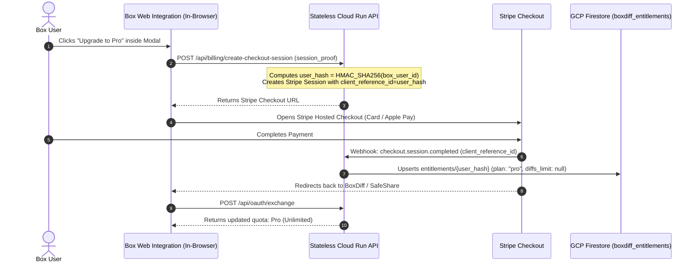
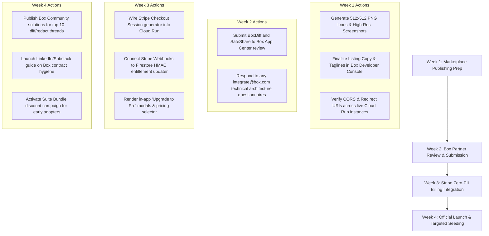

# Box Suite Commercial & Go-To-Market Master Plan: BoxDiff & SafeShare

**Authoritative Strategy, Freemium Packaging, Tiered Pricing, and Distribution Playbook for Box.com Web App Integrations**

---

## 1. Executive Summary & Product Positioning

**SafeShare** and **BoxDiff** form a complementary, privacy-first **Everyday File Governance & Productivity Suite** for Box.com. They bridge the *"Everyday User Gap"* in the Box App Center—delivering capabilities that previously required either clunky desktop software (Adobe Acrobat, Draftable, Workshare) or heavyweight enterprise compliance appliances (TeraDact, Box Shield).

```
┌──────────────────────────────────────────────────────────────────────────────────┐
│                             THE BOX EVERYDAY SUITE                               │
├─────────────────────────────────────────┬────────────────────────────────────────┤
│          SafeShare for Box              │            BoxDiff for Box             │
│   (Privacy, Redaction & Hygiene)        │    (Version Redlines & Diff Audits)    │
├─────────────────────────────────────────┼────────────────────────────────────────┤
│ • Pre-Share Privacy X-Ray (Metadata)    │ • Text & Contract Redlines (Patience)  │
│ • True Byte-Level PII/PHI Redaction     │ • Visual Curtain & Crimson Pixel Diff  │
│ • ShareRadar Shared Link & Guest Audit  │ • Multi-Sheet Excel Formula Audit      │
│ • Zero unredacted version leaks         │ • 1-Click Executive PDF Report to Box  │
├─────────────────────────────────────────┴────────────────────────────────────────┤
│             UNFAIR ADVANTAGE: 100% IN-BROWSER RAM · ZERO-PII RETENTION           │
│        Zero file bytes ever touch GCP servers · Near-$0 marginal compute         │
└──────────────────────────────────────────────────────────────────────────────────┘
```

### The Unfair Advantage (Cost Structure & Trust)
Traditional competitors (e.g., Draftable, Redactable, Workshare) run expensive backend server clusters with headless LibreOffice, OCR GPUs, and multi-gigabyte storage buckets. Because their marginal compute cost per document is high, they are forced to charge \$20–\$30/user/month with strict document volume ceilings.

By contrast, **SafeShare and BoxDiff execute 100% inside the user's web browser memory (via WebAssembly and Canvas)** directly through Box CORS (`api.box.com` and `upload.box.com`). 
- **Server compute cost:** Near-\$0 (stateless Cloud Run handles only short-lived OAuth exchanges and cryptographic HMAC tokens).
- **Security clearance:** Enterprise IT security teams approve it quickly because user documents never leave Box or reside on third-party servers.
- **Gross Margins:** 95%+ on Pro subscriptions, enabling a generous Free tier that drives rapid, viral product-led growth (PLG).

---

## 2. Product Breakdown: SafeShare vs. BoxDiff

### A. SafeShare for Box
* **Everyday Problem:** Users frequently create Box Shared Links for sensitive documents (tax forms, medical intake, passports, vendor contracts) without realizing smartphone photos embed hidden home GPS coordinates/camera serials, PDFs embed hidden author names/revision logs, and drawn black boxes in previewers leave underlying text easily highlightable and copyable. Furthermore, users have no way to audit forgotten active public links across nested subfolders without checking folders one-by-one.
* **Core Capabilities:**
  1. **Privacy X-Ray & Metadata Scrubber:** Automatically strips EXIF, GPS location coordinates, camera serials, embedded thumbnail caches, PDF author details/creation tools, and Word revision trails.
  2. **True Byte-Destructive Redaction:** Scans document text layers for sensitive patterns (SSNs, credit cards, bank accounts, emails, phone numbers, custom terms) or lets users drag blackout boxes over signatures/faces. Permanently burns solid redactions into a clean `_SafeCopy` file so raw text is destroyed forever.
  3. **ShareRadar Link & Collaborator Hygiene:** Scans nested Box subfolders in seconds (metadata only) to discover open public links, monitor live Open (`preview_count`) and Download counts, track recent traffic spikes (`+Δ`), and pinpoint stale external guests—with 1-click bulk link revocation, expiry stamping, and permission downgrading.

### B. BoxDiff for Box
* **Everyday Problem:** Box automatically preserves Version History (`v1`, `v2`, `v3`...), yet when someone uploads a revised contract or spreadsheet, users must open versions in separate browser tabs and squint back-and-forth, or download both files to use desktop comparison tools. Box has zero built-in browser visual diffing or redlining.
* **Core Capabilities:**
  1. **Document & Contract Redline:** Patience-anchored line matching with word-level insertions and deletions across `.pdf`, `.docx`, `.txt`, `.md`, `.json`, and `.csv`. Features **cross-format comparison** (compare a `.docx` contract draft against a signed counterparty `.pdf`). Surfaces instant smart cards for modified **\$ Amounts**, **% Rates**, **Dates / Terms**, and **Legal Clauses** (`indemnity`, `termination`, `liability`).
  2. **Visual Curtain & Pixel Diff:** Draggable before/after split-screen curtain slider and crimson pixel-difference overlay with live threshold adjustment for scanned PDFs, signed lease pages, architectural drawings, and slide decks. Multi-page quick delta strip (`P1 0%`, `P3 2.8% Δ`) allows immediate navigation to changed pages.
  3. **Multi-Sheet Excel Formula & Override Audit:** Parses OpenXML `.xlsx` and `.csv` files directly in RAM. Audits both formulas (`<f>`) and evaluated values (`<v>`), specifically alerting when a calculation formula is overwritten with a hardcoded static number.
  4. **1-Click Executive PDF Report:** Generates a clean `Redline_Report_<Name>.pdf` in memory and saves it straight back to the Box folder, with a 1-click shared link copy.

---

## 3. Freemium Pricing Architecture

### Pricing Psychology in the Box Ecosystem
Box enterprise and business users already pay **\$15 to \$35 per user/month** for Box Business Plus or Enterprise. Corporate employees, legal teams, recruiters, and consultants have corporate credit cards with self-serve expense limits up to \$50–\$100/month without procurement friction.

To maximize adoption while capturing revenue from high-volume power users and corporate departments, we propose a **3-Tier Freemium Model with a Suite Bundle Discount**:

| Tier | SafeShare Alone | BoxDiff Alone | **Suite Bundle (Both Apps)** | Target Audience |
| :--- | :--- | :--- | :--- | :--- |
| **Free Forever** | \$0 | \$0 | **\$0** | Casual / ad-hoc Box users, external collaborators |
| **Pro (Individual)** | \$10/mo (\$99/yr) | \$12/mo (\$119/yr) | **\$16/mo (\$149/yr)** *(Save 27%)* | Lawyers, accountants, consultants, procurement, ops |
| **Team (5–25 Seats)** | \$7/user/mo | \$8/user/mo | **\$11/user/mo** | Boutique law firms, clinics, agencies, accounting teams |
| **Enterprise Domain** | Custom (\$1,500/yr) | Custom (\$2,000/yr) | **Custom (\$2,900/yr flat)** | IT Admins rolling out org-wide to 50–500+ Box seats |

---

## 4. Feature Matrix: Free vs. Pro vs. Team

### SafeShare Feature Segmentation

| Capability | Free Tier | Pro Tier (\$10/mo) | Team / Enterprise |
| :--- | :---: | :---: | :---: |
| **Monthly Document Clean/Redact Cap** | 10 files / month | **Unlimited** | **Unlimited** |
| **Metadata Stripping (EXIF, GPS, Author)** | Full (100%) | Full (100%) | Full (100%) |
| **Manual Box Drag-to-Blackout** | Yes | Yes | Yes |
| **Auto-Detect Regex Patterns** | SSN, Phone, Email | SSN, Phone, Email, Credit Cards, Bank Routing | All + Custom Regex Library |
| **Multi-Page Document Redaction** | Up to 10 pages | **Unlimited pages** | **Unlimited pages** |
| **Word (`.docx`) In-Place Redaction** | Basic | Full XML Preservation | Full XML Preservation |
| **ShareRadar Subfolder Depth** | 1 folder (up to 25 items) | **Recursive Unlimited Subfolders** | **Recursive Unlimited Subfolders** |
| **ShareRadar Bulk Remediation** | Manual 1-by-1 | **1-Click Bulk Revoke & Expiry** | **1-Click Bulk Revoke & Expiry** |
| **ShareRadar CSV Hygiene Export** | No | **Yes** | **Yes** |
| **Branding on Saved Copies** | Subtle SafeShare tag | **Zero Branding / Clean** | **Custom Corporate Branding** |
| **Centralized Admin Billing / SSO** | No | No | **Yes (Box Domain Binding)** |

### BoxDiff Feature Segmentation

| Capability | Free Tier | Pro Tier (\$12/mo) | Team / Enterprise |
| :--- | :---: | :---: | :---: |
| **Monthly Comparison Quota** | 5 diffs / month | **Unlimited** | **Unlimited** |
| **Text Redline Length Limit** | Up to 20 pages | **Unlimited pages** | **Unlimited pages** |
| **Smart Financial & Clause Callouts** | Top 3 callouts | **All Callouts & Direct Jump** | **All Callouts & Direct Jump** |
| **Visual Curtain & Pixel Slider** | Single page only | **Full Multi-Page + Delta Strip** | **Full Multi-Page + Delta Strip** |
| **Cross-Format Diff (`.docx` vs `.pdf`)** | Included | Included | Included |
| **Spreadsheet Audit (`.xlsx`, `.csv`)** | 1st Worksheet Only | **Multi-Sheet + Formula Overrides** | **Multi-Sheet + Formula Overrides** |
| **Export `Redline_Report.pdf` to Box** | Watermarked footer | **Clean Executive PDF (No Watermark)** | **Custom Corporate Header & Logo** |
| **Side-by-Side Synchronized Scroll** | Included | Included | Included |
| **Centralized Admin Billing / Seats** | No | No | **Yes (Box Domain Binding)** |

---

## 5. Monetization Engine: Zero-PII Stripe Billing

To maintain our core marketing and security promise (**Zero-PII**), billing is tied to Box user IDs without storing credit cards, names, or unencrypted emails on our servers:



---

## 6. Go-To-Market (GTM) & Distribution Strategy

### Pillar 1: Box App Center Optimization (ASO)
The Box App Center has high-intent organic traffic from enterprise workers searching for solutions to immediate roadblocks.
* **Category Placement:**
  * SafeShare: *Security & Compliance*, *Productivity*, *Legal*
  * BoxDiff: *Legal*, *Finance & Accounting*, *Productivity*
* **Keyword Optimization:**
  * Primary keywords: `"diff"`, `"redline"`, `"compare versions"`, `"version history"`, `"redact pdf"`, `"scrub metadata"`, `"exif"`, `"audit shared links"`, `"external users"`, `"excel formula audit"`.
* **Action-Oriented Integration Titles in Box Context Menu:**
  * Rather than generic company names, use direct verb phrases:
    * `Compare with BoxDiff`
    * `Scrub & Redact with SafeShare`
    * `Audit Links & Guests (SafeShare)`

### Pillar 2: Product-Led Growth (PLG) & Viral In-File Billboards
Every document processed by the Free tier becomes an organic acquisition channel:
1. **The Shared Redline Report:** When a user compares two versions of an agreement and clicks **Save Report PDF to Box**, `Redline_Report_MSA_v2_vs_v3.pdf` is placed into the shared Box folder. Every executive, client, and counterparty who opens that PDF sees a subtle, professional footer note:
   > *Generated privately in-browser via BoxDiff for Box · Compare your versions at boxdiff.app*
2. **The Clean `_SafeCopy` File:** When SafeShare outputs `Invoice_SafeCopy.pdf`, collaborators notice the clean, sanitized deliverable and want to know how it was prepared without desktop Adobe Acrobat.

### Pillar 3: Box Community & Pulse Direct Engagement
The Box Community forum (`community.box.com`) and Box Pulse feature request board (`pulse.box.com`) contain hundreds of threads where users voice frustration about native gaps:
* **BoxDiff Opportunities:** Threads asking *"How do I compare two versions of a document in Box?"* or *"Can Box highlight text differences between uploads?"*
* **SafeShare Opportunities:** Threads asking *"How can I see all active shared links created in my account?"*, *"How to remove EXIF GPS from photos uploaded to Box"*, and *"How to redact text in Box Preview without downloading"*.
* **Playbook:** Provide respectful, thorough answers explaining the technical constraints and introducing the free Box integration as an immediate 1-click in-browser solution.

### Pillar 4: High-Value Industry Vertical Outbound

```
┌────────────────────────────────────────────────────────────────────────┐
│                        TARGET VERTICAL PLAYBOOK                        │
├─────────────────────┬──────────────────────────────────────────────────┤
│ Legal Ops & Law     │ • Primary Pitch: In-browser contract redlining   │
│ Firms               │   (.docx vs .pdf) + client-side metadata wipe.   │
│                     │ • Hook: Prevent opposing counsel metadata leaks. │
├─────────────────────┼──────────────────────────────────────────────────┤
│ Accounting, Tax &   │ • Primary Pitch: Excel formula audit & override  │
│ Fractional CFOs     │   alerts + PII redactor on W-9s & tax filings.   │
│                     │ • Hook: Catch silent formula overrides in .xlsx. │
├─────────────────────┼──────────────────────────────────────────────────┤
│ Healthcare & HIPAA  │ • Primary Pitch: Zero-PII sanitization for IDs   │
│ Clinics             │   and intake scans before external consults.     │
│                     │ • Hook: Zero file bytes ever touch cloud servers.│
├─────────────────────┼──────────────────────────────────────────────────┤
│ Architecture, Eng.  │ • Primary Pitch: Draggable visual curtain diff   │
│ & Construction      │   for architectural blueprint revisions.         │
│                     │ • Hook: Spot layout shifts and moved stamps.     │
└─────────────────────┴──────────────────────────────────────────────────┘
```

### Pillar 5: Box Developer & Partner Ecosystem Co-Marketing
1. **Box Partner Program:** Register as a Box Technology Partner (`integrate@box.com`). Box frequently spotlights partners who showcase the power of Box APIs, especially those with clean, security-conscious designs that respect enterprise compliance.
2. **Box Blog & Developer Spotlight:** Pitch a technical case study: *"How BoxDiff Built 100% Client-Side WebAssembly File Redlining using Box CORS APIs"*.
3. **BoxWorks & Box Local User Groups:** Deliver lightning talks or digital booth demos highlighting everyday administrative and legal workflows in Box.

---

## 7. Immediate 30-Day Execution Roadmap



---

## 8. Summary of Commercial Success Metrics (KPIs)

1. **Install Rate:** Ratio of Box App Center listing page views to integration authorizations (> 15% target).
2. **Viral Coefficient ($K$):** Number of new users acquired per Free tier `Redline_Report.pdf` or `_SafeCopy` saved to a shared folder ($K > 0.35$ target).
3. **Free-to-Paid Conversion Rate:** % of free users who hit the monthly cap (5 diffs / 10 scrubs) and convert to Pro (> 4.5% target).
4. **Gross Margin:** Maintain > 94% gross margin due to client-side compute architecture.
5. **Churn Rate:** < 3.5% monthly churn for annual Pro and Team accounts.
